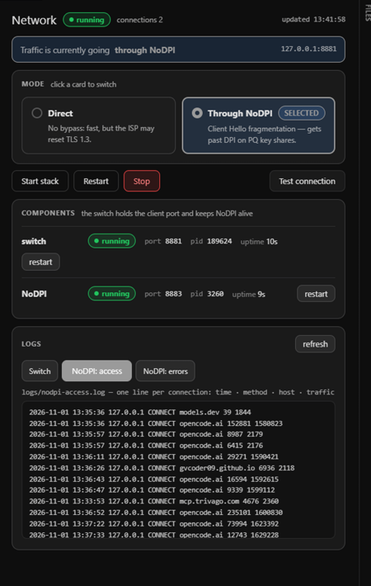

# Hermes desktop panel (optional)

A page inside the [Hermes desktop app] that shows the stack the way an operator needs it:
which mode is active, whether each component is alive, the buttons to change that, and the
three logs.

It is a facade over `lifecycle.Stack` — the same code `net.py` uses — so there is no second
implementation of start/stop that could disagree with the CLI.



## What it shows

- **Mode**: two radio cards, the active one outlined and marked `SELECTED`, disabled while
  the stack is down.
- **Components**: switch and NoDPI with state, port, pid, uptime, automatic restart counter,
  per-component restart button.
- **Logs**: three tabs — switch connections, `nodpi-access.log`, `nodpi-error.log`.
- **Honest empty state**: while the first response is missing the page says "Loading
  state…" instead of claiming the stack is stopped.

## Install

The app loads plugins from `<hermes home>/desktop-plugins/<id>/`, and the Python backend from
`<hermes home>/plugins/<id>/dashboard/`.

```bash
# 1. frontend
mkdir -p "<hermes>/desktop-plugins/nodpi-supervisor"
cp integrations/hermes/frontend/plugin.js "<hermes>/desktop-plugins/nodpi-supervisor/"

# 2. backend
mkdir -p "<hermes>/plugins/nodpi-supervisor/dashboard"
cp integrations/hermes/backend/plugin_api.py "<hermes>/plugins/nodpi-supervisor/dashboard/"

# 3. enable it (config is edited only through the CLI)
hermes config set plugins.enabled '["nodpi-supervisor"]'   # merge with your existing list
```

The backend finds the core through `NODPI_SUPERVISOR_HOME`; set it to your checkout:

```bash
setx NODPI_SUPERVISOR_HOME "D:\AI\nodpi-supervisor"
```

Without it, the backend walks three levels up from its own file, which works when you copy
the repository as `plugins/nodpi-supervisor/dashboard/` inside the Hermes tree.

Restart the app, then open **Network** in the sidebar.

## Notes

- The backend starts a watchdog thread, so the switch is brought back if it dies while the
  app is open. "Stop" in the panel is respected: it writes `desired=false`.
- Everything the panel does is also available from `net.py`, so the app is a convenience,
  not a requirement.

[Hermes desktop app]: https://hermes-agent.nousresearch.com/docs
